# Lunar Landing Site Navigator

[](https://www.spaceappschallenge.org/)
[](https://ssd.jpl.nasa.gov/horizons/)
[](https://github.com/AHMADALIPARR/lunar-navigator/blob/main/src/nav.c)
[](https://github.com/AHMADALIPARR/lunar-navigator/blob/main/out/index.html)
[](https://github.com/AHMADALIPARR/lunar-navigator/blob/main/LICENSE)

**Mons Mouton Plateau wins: the Sun never sets for 14 days, and Earth never drops below +11°.** Nine Artemis III regions, one winner, every number traced to a JPL Horizons row.

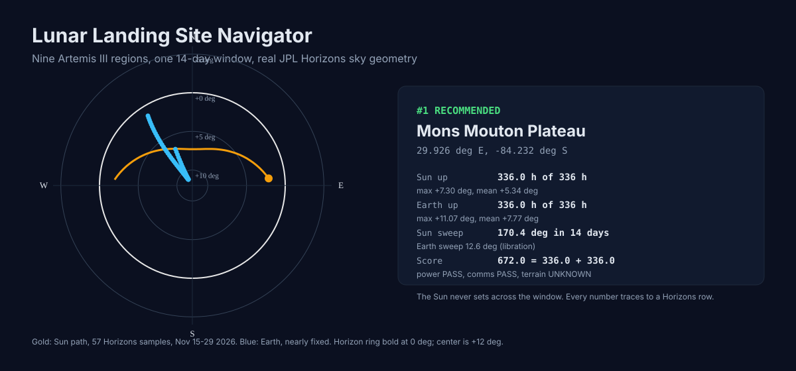

*Hero: the Sun path over Mons Mouton Plateau, plotted from the 57 real JPL Horizons samples in `data/csv/mmp-sun.csv` through the same polar projection the navigator draws itself. Gold is the Sun, blue dots are Earth. The Sun never crosses the bold horizon ring.*

Quick links: [The problem](#the-navigation-problem) · [Architecture](#system-architecture) · [Mathematics](#mathematical-foundations) · [Results](#the-results) · [Sky domes](#the-nine-sky-domes) · [Installation](#installation-and-reproduction) · [Demonstration](#demonstration) · [Verification](#verification-and-testing)

This is Team SnapKitty's entry for the NASA International Space Apps Challenge 2026, challenge Lunar Landing Site Navigator, submitted by Ahmad Ali Parr. It is built with Muse as the disclosed AI tool; the numbers come from JPL Horizons, not from the AI.

## Run it in two minutes

```sh
git clone https://github.com/AHMADALIPARR/lunar-navigator.git
cd lunar-navigator
make            # builds the navigator, renders the nine sky domes, generates the page
```

Then open `out/index.html` in any browser. No server, no JavaScript, no network calls. You need a C11 compiler (`gcc`) and `make`; the sky domes also need `xvfb-run` and `ffmpeg`. If you do not have those two, run `make run` instead — it builds the navigator and the page, and the page falls back to the SVG polar plots it draws itself. The Horizons data is already in `data/`, so no internet is needed to run it. See [How to run it](#how-to-run-it) for the full guide.

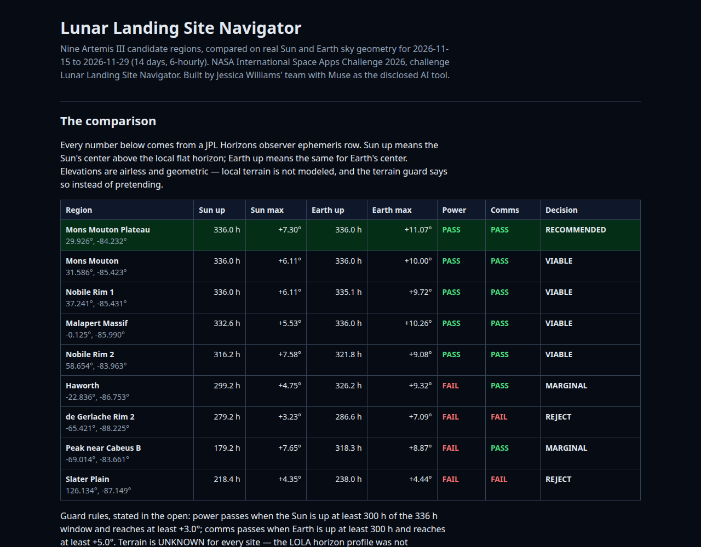

*The page the program generates: the comparison table, one 3D sky dome per site, and the decision ledger — a single file, no JavaScript. Mons Mouton Plateau takes the green row.*

## The navigation problem

At the lunar south pole the Sun never rises high. It circles the horizon, a few degrees up at best, and over a two-week stay it can spend days below it. Earth hangs almost still in the sky — its elevation is set by where you stand, and from some regions it never climbs high enough for a comfortable direct link. A site that looks good on a map can be dark half the time or deaf to Earth, so choosing a site means comparing sites *and* dates on those two windows at once. That is the whole job of this navigator.

The entry answers one question: for the window November 15–29, 2026, which of the nine candidate regions gives a surface crew the best combined sky — the most sunlit hours for power, and the most Earth-visible hours for communications? The answer is Mons Mouton Plateau: the Sun never sets across the window, and Earth never drops below +11 degrees. The page shows the full comparison so the answer can be checked, not just believed.

### Scope: what this is, and what it is not

This is **landing-site assessment**, not traverse planning. The navigator compares nine fixed regions on sky geometry. It does not plan routes between sites, does not model rover mobility, does not compute terrain slope, and does not do hazard avoidance — there is no terrain model in this repository at all, and the terrain guard says UNKNOWN for every site rather than pretending otherwise. No inter-site distances are computed: the sites are compared independently, each on its own Sun and Earth windows, and the ranking is on combined up-hours. Nothing here is a landing recommendation; it is a comparison of sky geometry, and the decision column says which site wins that comparison.

Lunar navigation differs from terrestrial navigation in the ways that matter here. There is no GPS: position comes from the sky, and at the pole the sky itself is strange. The Sun does not rise and set the way it does on Earth — it circles the horizon, so a few degrees of elevation decide whether a site has power or sits in darkness for days. Earth barely moves — its sweep over 14 days is about 12 degrees, against about 170 for the Sun — so communications is a property of the site, not the hour. The navigator is built around those two facts: it measures the two windows, and nothing else decides the ranking.

## System architecture

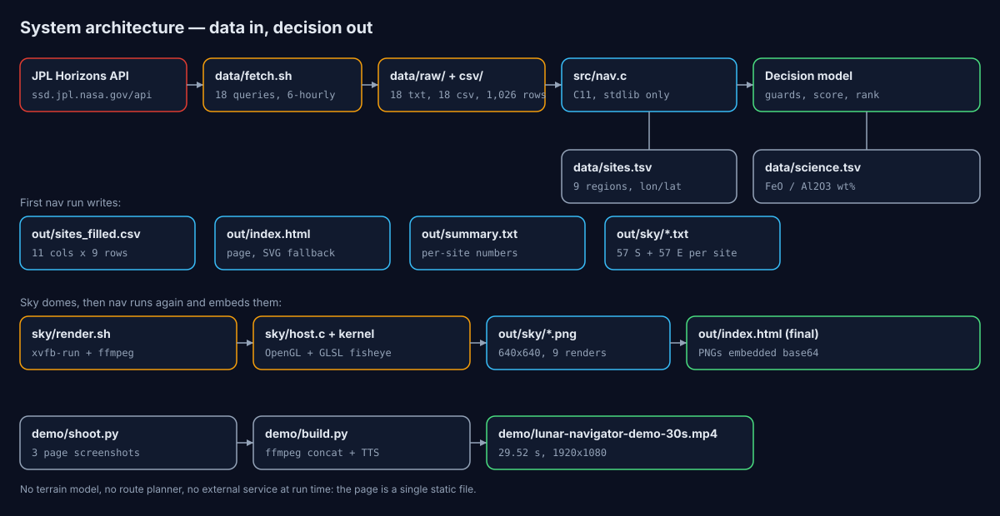

*Architecture: every box names a real file. The pipeline is linear — data in, decision out — with no external service at run time.*

| Component | File | What it does |
|---|---|---|
| Ephemeris fetch | `data/fetch.sh` | Pulls Sun + Earth apparent azimuth/elevation from the JPL Horizons API, 18 queries, 6-hourly, Nov 15–29 2026 |
| Raw data | `data/raw/*.txt` | Raw Horizons output, 18 files, kept so anyone can check the numbers against the source |
| Tables | `data/csv/*.csv` | Extracted Sun/Earth tables, 18 files, 1,026 rows total, 57 rows per query |
| Regions | `data/sites.tsv` | The nine regions and their coordinates (NASA Oct 28, 2024 update) |
| Science | `data/science.tsv` | Oxide abundances per region (FeO, Al2O3 wt%) |
| Navigator | `src/nav.c` | C11, standard library only: parses the tables, computes the windows, applies the guards, ranks the sites, writes the outputs |
| Decision table | `out/sites_filled.csv` | 11 columns × 9 rows: region, windows, science, guards, decision, reason, tradeoff, source |
| Page | `out/index.html` | The navigator page: comparison table, sky domes, decision ledger, science table — one file, no JavaScript |
| Numbers | `out/summary.txt` | Plain-text per-site numbers, rank order |
| Sky data | `out/sky/*.txt` | Per-site Sun/Earth samples for the GLSL dome kernel |
| Dome renderer | `sky/render.sh`, `sky/host.c`, `sky/kernel_skydome.frag` | OpenGL host + GLSL fisheye kernel, renders each dome to 640×640 PNG under `xvfb-run` |
| Demo | `demo/shoot.py`, `demo/build.py` | Three page screenshots + AI-narrated audio → the 30-second demo video |

The build has two passes by design. The first `nav` run writes the page with SVG polar plots. `sky/render.sh` then renders the nine domes from the same samples, and `nav` runs again to embed the PNGs base64 in the page. The page stays a single file either way, and the SVG plot remains as the fallback when no render exists.

```
lunar-navigator/
  src/nav.c               the navigator program (C11, standard library only)
  Makefile                builds nav and regenerates the outputs
  data/
    sites.tsv             the nine regions and their coordinates
    science.tsv           oxide abundances per region
    fetch.sh              re-pulls the Horizons tables
    raw/                  raw Horizons output, 18 query files
    csv/                  extracted Sun/Earth tables, 18 files, 1,026 rows
  out/
    index.html            the navigator page (generated)
    sites_filled.csv      the decision-model table, filled from data
    summary.txt           plain-text per-site numbers
    sky/                  per-site sky samples (.txt) and dome renders (.png)
  sky/
    host.c                the OpenGL host, extended with a sky data-file argument
    kernel_skydome.frag   the GLSL sky-dome kernel (fisheye sky, Sun path, Earth dots)
    passthrough.vert      vertex passthrough for the full-screen quad
    render.sh             renders all nine sky domes from the Horizons samples
  docs/assets/            hero, architecture, sky-geometry, and window diagrams (SVG)
  images/
    page-hero.png         screenshot of the generated page
    mmp.png, mm.png ...   the nine rendered sky domes, one per region
  demo/
    lunar-navigator-demo-30s.mp4   the 30-second demo video
  README.md               this file
  SUBMISSION.md           the text for the Project tab form
  AI_DISCLOSURE.md        tool-by-tool record of AI use
  STATUS.md               what is verified and what is still owed
  LICENSE                 SNAPKITTY OPAQUE SOURCE LICENSE v1.0
  WATERMARK.md            hash-chained manifest of the tree
```

## Mathematical foundations

Everything in this section is implemented in `src/nav.c` (`body_metrics`, `compute_all`) or in `sky/kernel_skydome.frag`. Nothing here is background only: if a formula appears below, the code computes it.

### Time

Each Horizons row carries a datetime like `2026-Nov-15 00:00`. The navigator converts it to hours since 2026-11-15 00:00 UTC (`parse_hours` in `src/nav.c`). 2026 is not a leap year; November 15 is day 319. Samples are 6 hours apart, 57 per body per site, covering the 336-hour window.

### Up-hours: linear interpolation across the horizon

For each body, the navigator integrates the time its elevation is above 0° — the local flat horizon. Between two consecutive samples 6 hours apart, the crossing is found by linear interpolation:

$$\text{frac} = \frac{0 - e_0}{e_1 - e_0}$$

where $e_0$ and $e_1$ are the elevations at the two samples. If both are above 0, the whole 6 hours count; if both are below, none do; if they straddle the horizon, the above-horizon fraction is `frac · dt` when the interval starts up, or `(1 − frac) · dt` when it starts down. Summing over the 56 intervals gives the up-hours. The longest continuous stretch is accumulated the same way, closing a stretch whenever an interval is only partly above the horizon. The true crossing can differ by minutes from the interpolated one — that is a stated limit, not a hidden one.

### Azimuth sweep: unwrapping

Azimuth wraps at 360°, so a Sun path crossing north would read as a jump. The navigator unwraps each step into (−180°, +180°] before accumulating:

$$d_i = \text{wrap}(az_i - az_{i-1}), \qquad \text{sweep} = \max(u) - \min(u)$$

where $u$ is the unwrapped azimuth series. The Sun sweeps about 170° over the 14 days at every site — half a lunar month. Earth sweeps only about 12°, which is libration: Earth barely moves in the lunar sky.

### The sky projections

One sky, two renderers, one projection idea: a polar plot with the zenith at the center and the horizon as a ring.

**SVG polar plot** (`svg_sky` in `src/nav.c`). Center is +12°, outer ring is −6°, so the horizon (0°) sits at two-thirds of the radius:

$$r = R\,\frac{12 - el}{18}, \qquad x = cx + r\sin(az), \qquad y = cy - r\cos(az)$$

Rings are drawn at −5°, 0°, +5°, +10°, with the horizon ring bold. The Sun path is split at the horizon with interpolated crossing endpoints, so no line ever cuts across the below-horizon region: gold solid above, grey dashed below. Earth is one blue dot per sample.

**GLSL fisheye dome** (`sky/kernel_skydome.frag`). The fragment shader inverts the mapping: for each pixel, radius from the center gives elevation, angle gives azimuth:

$$el = 90 - r \cdot 100, \qquad az = \text{atan}(ndc.x,\; ndc.y)$$

Center is the zenith (+90°), edge is −10°, so the bold horizon ring sits at 0.9 of the radius and the below-horizon part of a path stays visible instead of being clipped. North is up, azimuth grows clockwise. Each sample becomes a unit direction:

$$\mathbf{d} = (\cos el \sin az,\; \sin el,\; \cos el \cos az)$$

and the Sun path is drawn by angular distance from each pixel's direction to the nearest path segment (`acos` of the dot product, clamped). The grid is elevation rings at +30°/+60° and azimuth spokes every 30°. The bright discs mark both bodies at mid-window (sample 28, Nov 22 00:00 UTC), drawn larger than their true angular size (Sun 0.27°, Earth 0.95°) so they read at 640 px — the page says so.

### Guards, score, rank

The decision model is three stated rules and one score, all in `compute_all`:

$$\text{POWER passes} \iff \text{sun\_up} \ge 300\ \text{h} \land \text{sun\_max} \ge +3.0°$$

$$\text{COMMS passes} \iff \text{earth\_up} \ge 300\ \text{h} \land \text{earth\_max} \ge +5.0°$$

$$\text{score} = \text{sun\_up} + \text{earth\_up}$$

Sites rank by score, descending; an exact tie is broken by the sum of the two maximum elevations. Both guards passing makes the rank-1 site RECOMMENDED and the other passing sites VIABLE; one guard failing is MARGINAL; both failing is REJECT. Terrain is UNKNOWN for every site — the LOLA horizon profile was not computed, so no site claims a terrain pass.

### What is not computed

No inter-site distances: the haversine-style spherical formula $d = R \arccos[\sin\phi_1\sin\phi_2 + \cos\phi_1\cos\phi_2\cos\Delta\lambda]$ appears nowhere in the code, because the sites are never compared by distance — each is judged on its own sky. No terrain slope, no gradient, no route cost function, no search algorithm (no A*, no Dijkstra): there is no graph to search, because the problem is choosing among nine fixed regions, not finding a path between them.

## The results

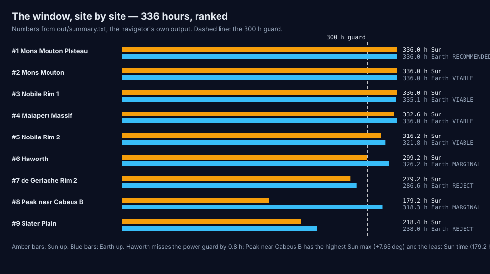

*The window, site by site, from `out/summary.txt` — the navigator's own output. Dashed line: the 300-hour guard.*

| Rank | Region | Sun up | Sun max | Earth up | Earth max | Score | Decision |
|---|---|---|---|---|---|---|---|
| 1 | Mons Mouton Plateau | 336.0 h | +7.30° | 336.0 h | +11.07° | 672.0 | RECOMMENDED |
| 2 | Mons Mouton | 336.0 h | +6.11° | 336.0 h | +10.00° | 672.0 | VIABLE |
| 3 | Nobile Rim 1 | 336.0 h | +6.11° | 335.1 h | +9.72° | 671.1 | VIABLE |
| 4 | Malapert Massif | 332.6 h | +5.53° | 336.0 h | +10.26° | 668.6 | VIABLE |
| 5 | Nobile Rim 2 | 316.2 h | +7.58° | 321.8 h | +9.08° | 638.0 | VIABLE |
| 6 | Haworth | 299.2 h | +4.75° | 326.2 h | +9.32° | 625.3 | MARGINAL |
| 7 | de Gerlache Rim 2 | 279.2 h | +3.23° | 286.6 h | +7.09° | 565.8 | REJECT |
| 8 | Peak near Cabeus B | 179.2 h | +7.65° | 318.3 h | +8.87° | 497.5 | MARGINAL |
| 9 | Slater Plain | 218.4 h | +4.35° | 238.0 h | +4.44° | 456.4 | REJECT |

Mons Mouton Plateau and Mons Mouton tie on score at 672.0; the tie-break (sum of maximum elevations, +18.37° vs +16.11°) puts the Plateau first. Haworth misses the power guard by 0.8 hours — the closest call in the table. Peak near Cabeus B has the highest Sun maximum (+7.65°) and the least Sun time (179.2 h): the brightest site is dark half the window. Slater Plain fails both guards and has the lowest Earth maximum (+4.44°), below the +5.0° comms threshold on its own.

The full per-site numbers — means, longest stretches, sweeps, first/last up times, reasons, tradeoffs — are in `out/summary.txt` and in the decision ledger on the page.

## The nine sky domes

One 3D sky dome per region, rendered by the OpenGL host and the GLSL sky-dome kernel from the same 57 Horizons samples behind the table — no invented scenery. The center is the zenith, the bold ring is the horizon (0°), the edge is −10°, north is up. The gold line is the Sun's path across the 14 days — solid while it is up, dashed grey while it is down. The blue dots are Earth, which barely moves in the lunar sky; the bright discs mark both bodies at mid-window (Nov 22 00:00 UTC), drawn larger than their true size so they read. At the pole the Sun circles the horizon instead of rising and setting the way it does on Earth.

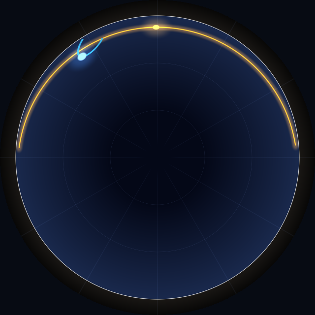  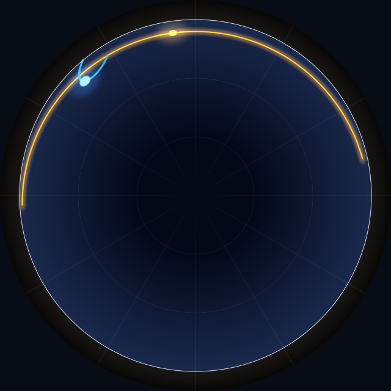
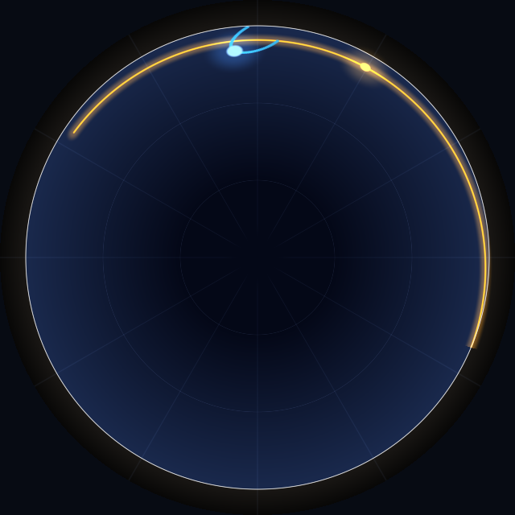 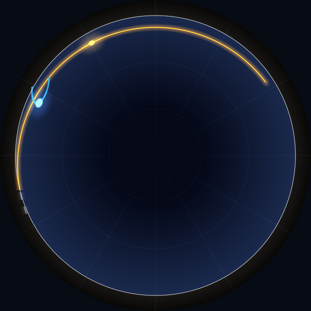 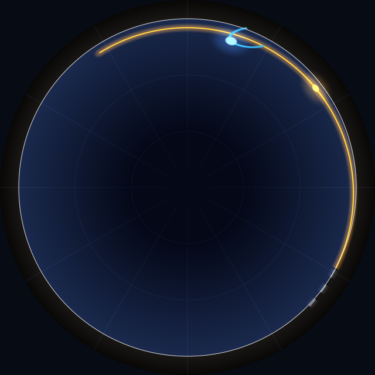
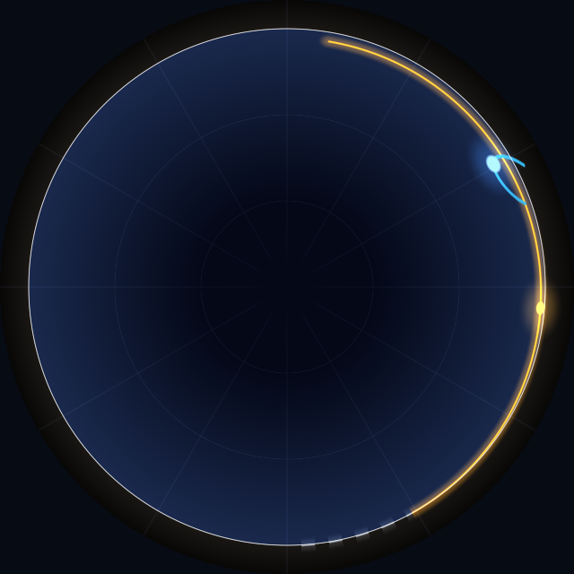 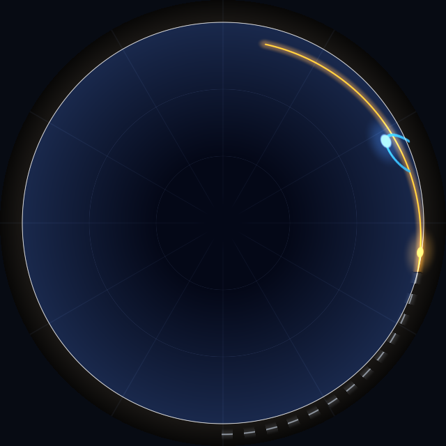 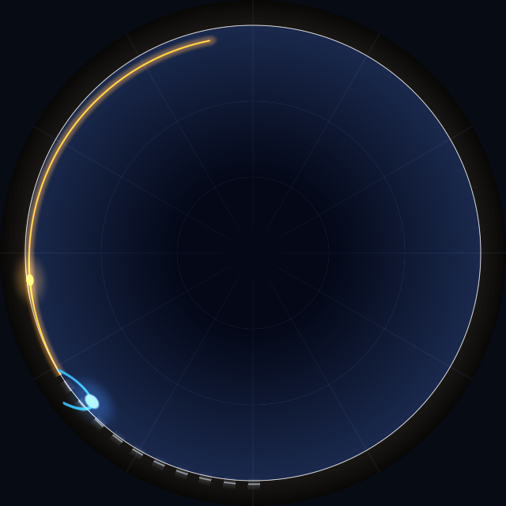

*Mons Mouton Plateau, Mons Mouton, Nobile Rim 1, Malapert Massif, Nobile Rim 2, Haworth, de Gerlache Rim 2, Peak near Cabeus B, Slater Plain — in rank order. Mons Mouton Plateau's gold arc is unbroken: the Sun never sets. Peak near Cabeus B's arc breaks to dashed grey for the dark stretch.*

## Sky geometry

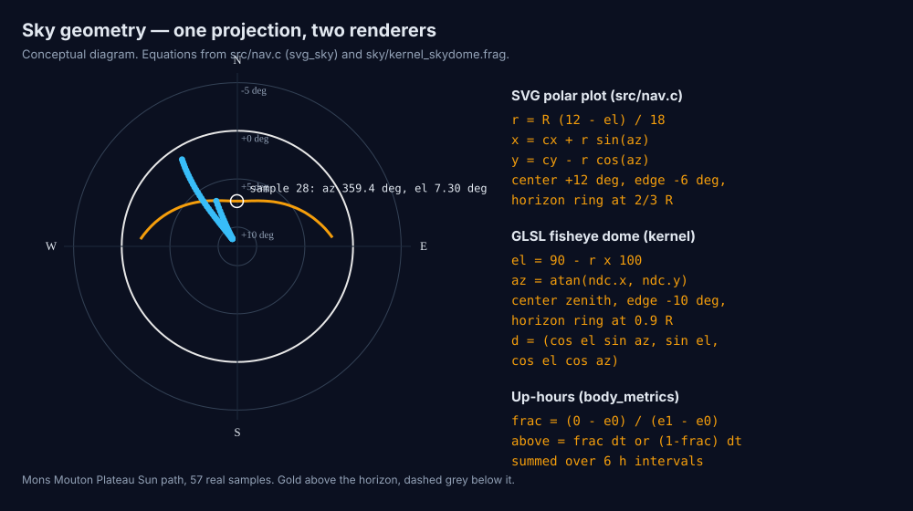

*Conceptual diagram. The projection equations come from `src/nav.c` (`svg_sky`) and `sky/kernel_skydome.frag`. The plotted path is Mons Mouton Plateau's real Sun samples.*

## The science table

Composition comes from Table 5 of the 1D-CNN preprint (Preprints.org, doi:10.20944/preprints202511.1488.v1 — preprint, not peer-reviewed), inverted from KAGUYA spectral data using Bian et al. (2025) oxide maps as training samples. All nine regions are feldspathic highland material — iron oxide under 6.2 weight percent, alumina over 25 weight percent — with small differences between them. Slater Plain and de Gerlache Rim 2 capture the most compositional diversity within feasible operational ranges, which is why those two regions stay in the conversation even though their sky geometry is the weakest. The decision ranks on sky access only; the science table is there so the reader can weigh the tradeoff themselves.

| Region | FeO wt% | Al2O3 wt% |
|---|---|---|
| Peak near Cabeus B | 5.92 | 25.75 |
| Haworth | 5.77 | 26.05 |
| Malapert Massif | 6.02 | 25.49 |
| Mons Mouton Plateau | 6.14 | 25.26 |
| Mons Mouton | 5.85 | 25.87 |
| Nobile Rim 1 | 6.04 | 25.49 |
| Nobile Rim 2 | 6.11 | 25.28 |
| de Gerlache Rim 2 | 5.84 | 25.94 |
| Slater Plain | 5.97 | 25.59 |

## Lunar terrain data

The data this entry actually uses, and where each piece came from:

- **Sun and Earth ephemeris — JPL Horizons System.** Observer tables, `QUANTITIES='4'` (airless apparent azimuth and elevation, degrees), via `https://ssd.jpl.nasa.gov/api/horizons.api` (Horizons API v1.3). Each query: target Sun (`COMMAND='10'`) or Earth (`COMMAND='399'`), center `coord@301` with the region's longitude/latitude/0 km, 2026-11-15 to 2026-11-29, every 6 hours — 57 rows per query, 18 queries, 1,026 rows total. The old endpoint `https://ssd-api.jpl.nasa.gov/horizons.api` returns 404; the current docs point at the `ssd.jpl.nasa.gov/api` host, which returns 200. The fetch script is `data/fetch.sh`; raw output is kept in `data/raw/`, extracted tables in `data/csv/`.
- **Region coordinates — NASA's October 28, 2024 update** of the nine Artemis III candidate regions, as tabulated in Table 4 of the 1D-CNN preprint (Preprints.org, doi:10.20944/preprints202511.1488.v1 — preprint, not peer-reviewed), cross-checked against the USGS ScienceBase values (agreement within about 1°, the regions themselves roughly 10–38 km across). In `data/sites.tsv`:

| Region | Longitude | Latitude |
|---|---|---|
| Peak near Cabeus B | -69.014 | -83.661 |
| Haworth | -22.836 | -86.753 |
| Malapert Massif | -0.125 | -85.990 |
| Mons Mouton Plateau | 29.926 | -84.232 |
| Mons Mouton | 31.586 | -85.423 |
| Nobile Rim 1 | 37.241 | -85.431 |
| Nobile Rim 2 | 58.654 | -83.963 |
| de Gerlache Rim 2 | -65.421 | -88.225 |
| Slater Plain | 126.134 | -87.149 |

- **Oxide abundances — Table 5 of the same preprint**, inverted from KAGUYA SP data using Bian et al. (2025) oxide maps as training samples. In `data/science.tsv`. The DOI is 10.20944/preprints202511.1488.v1; Bian et al. (2025) is a separate paper whose oxide maps the preprint used as training samples — the preprint is the source of the tables, and it is not peer-reviewed.
- **Not used, named honestly:** no LOLA horizon profile was computed, so no terrain masking exists in this repository. NASA Quickmap (LRO terrain and imagery) and NASA Moon Trek are listed as data sources for the follow-on work, not as inputs to these numbers.

## Installation and reproduction

### What you need

- A C11 compiler: `gcc` (the build uses `gcc -std=c11 -O2 -Wall -Wextra -lm`, zero warnings)
- `make`
- For the 3D sky domes only: `xvfb-run` (headless X) and `ffmpeg` (PPM → PNG)
- No other dependencies. No Python, no JavaScript, no network at run time — the Horizons data is already in `data/`.

### Build it

```sh
git clone https://github.com/AHMADALIPARR/lunar-navigator.git
cd lunar-navigator
make            # builds nav, runs it, renders the nine sky domes, regenerates the page
```

`make` runs three stages (`all: nav run sky`): compile `src/nav.c` to `./nav`, run `./nav data out` to write the CSV, the page, and the summary, then `./sky/render.sh` to render the domes and `./nav` again to embed them. The Makefile is 24 lines; every command in it is reproduced here verbatim.

### Re-pull the data

```sh
./data/fetch.sh   # re-pulls the 18 Horizons tables; skips files already present and complete
```

The script checks each raw file for the `$$EOE` end marker before skipping it, and fails loudly if a fetch returns no data. Re-running it against the same window reproduces the same 1,026 rows.

### What you get

- `out/index.html` — the navigator page. Open it in any browser; it is a single static file.
- `out/sites_filled.csv` — the decision-model table, 11 columns × 9 rows.
- `out/summary.txt` — the per-site numbers in rank order.
- `out/sky/*.png` — the nine dome renders, 640×640.

### How to run it

The short version is `make`. The stages, for anyone who wants to run them by hand:

```sh
make nav        # gcc -std=c11 -O2 -Wall -Wextra -o nav src/nav.c -lm
make run        # ./nav data out — page with SVG polar plots (no domes needed)
make sky        # ./sky/render.sh + ./nav again — page with the 3D dome renders
make clean      # removes nav and the generated outputs
```

`./nav` takes two optional arguments: the data directory (default `data`) and the output directory (default `out`). It prints one line per site in rank order and the list of files it wrote. It exits non-zero — loudly — if a table is missing, a site has mismatched Sun/Earth row counts, or a path is too long, instead of producing a partial page.

## Demonstration

The supported workflow, end to end:

1. **Pick the window.** The window is fixed by the data: November 15–29, 2026, 14 days, 6-hourly. To change it, edit `START`/`STOP` in `data/fetch.sh` and re-pull.
2. **Load the sites.** `data/sites.tsv` holds the nine regions; `data/science.tsv` holds the oxides. No other input exists.
3. **Run the navigator.** `make` builds, computes, and renders. The console prints the ranking: Mons Mouton Plateau first, Slater Plain last.
4. **Read the comparison table** at the top of `out/index.html`: Sun up, Sun max, Earth up, Earth max, guards, decision — rank order, the winner's row highlighted green.
5. **Inspect the sky over each site.** One dome per region, same samples as the table. Mons Mouton Plateau's gold arc never breaks; Peak near Cabeus B's breaks to dashed grey for 156.8 hours of darkness.
6. **Read the decision ledger.** One row per region: decision, reason in numbers, tradeoff. The full ledger is also `out/sites_filled.csv`.
7. **Watch the demo.** `demo/lunar-navigator-demo-30s.mp4` (29.52 s, 1920×1080): the comparison, the sky over each site, the decision — narrated with AI text-to-speech, labeled as such.

## Verification and testing

Every claim below was checked by running the code or the page, not by reading the code alone. Evidence lives in `STATUS.md` and in the repository's own outputs.

| Component | Test | Acceptance criterion | Evidence |
|---|---|---|---|
| Horizons endpoint | Probe the API host | Current docs endpoint returns 200 | `https://ssd.jpl.nasa.gov/api/horizons.api` returns 200; old `ssd-api` host returns 404 (2026-11-15 probe: Sun at lunar lon 0, lat −89.5, el +1.35°) |
| Data pull | `./data/fetch.sh`, count rows | 18 files × 57 rows = 1,026 rows | All 18 CSVs have 57 rows; raw files kept in `data/raw/` with `$$EOE` markers |
| Navigator build | `gcc -std=c11 -O2 -Wall -Wextra` | Zero warnings | Clean build, zero warnings; clean rebuild repeats it |
| Metrics | Independent recount of sweeps | Sun sweep ~170°, Earth sweep ~12° | Sun sweep 170.0–170.4° per site; Earth sweep 12.2–12.6° (libration) |
| Decision model | Parse `out/sites_filled.csv` | 11 columns × 9 rows; guards match `summary.txt` | Parses as 11 × 9; every guard and decision matches the summary numbers |
| Page | Headless Chromium render | Zero page errors; 9 sky views; 30 table rows | Rendered with zero page errors; comparison table and domes visually checked by screenshot |
| Sky domes | `make` clean rebuild | 9/9 renders, numbers byte-identical | 9/9 PNGs rendered; rebuild reproduces identical numbers (MMP still #1, 336.0 h / +7.30°) |
| Demo video | Frame check at t=5/17/27 | 30 s, 1920×1080, H.264 + AAC | 29.52 s, 1920×1080, peak −3.06 dB, RMS −25.9 dB; frames checked |
| Reproducibility | `make` from a clean tree | Same numbers, same ranking | `make run` rebuilds the outputs with identical numbers (verified 2026-11-15) |

What has **not** been measured: no test-coverage percentage is claimed (there is no test suite — the verification is the rebuild, the recount, and the render checks above). No performance benchmark is claimed: the navigator runs in well under a second on a laptop and the number was never formally timed, so no time is stated.

## NASA Space Apps Challenge alignment

- **The challenge problem.** Lunar Landing Site Navigator (Advanced/Intermediate): compare Artemis III candidate sites on the data that decides a landing. This entry answers it directly — nine regions, one window, a ranked recommendation with the numbers behind it.
- **Technical approach.** Real ephemeris, not a mock: 1,026 Horizons rows drive a C11 program that computes, guards, and ranks, and a GLSL kernel that renders the same samples as sky domes. Nothing is simulated and nothing is invented.
- **Innovation.** The sky *is* the instrument: at the pole the Sun circles the horizon and Earth barely moves, so the entry treats the two sky windows as the decision itself — and shows them, per site, as domes you can read at a glance.
- **Scientific relevance.** The numbers trace to JPL Horizons; the coordinates and oxides trace to the cited preprint, labeled as a preprint, not peer-reviewed; the limits (flat horizon, no terrain, 6-hour sampling) are stated on the page, not buried.
- **Practical usefulness.** A surface crew planning a 14-day stay gets the answer in one table: which site keeps the Sun up and Earth visible, and what each other site costs.
- **Reproducibility.** `make` from a clean clone reproduces the page with identical numbers; `data/fetch.sh` re-pulls the source data; every file the README references exists in the repository.
- **Presentation.** The page is a single static file — no server, no JavaScript — and the demo is 30 seconds.

## Limits, stated plainly

- Elevations are the target's center above a flat horizon — the Sun's and Earth's angular radii (about 0.27° and 0.95°) are not added, and no local terrain is modeled. At these grazing angles a nearby ridge changes the real illumination, so the terrain guard is UNKNOWN for every site until a LOLA horizon profile is computed.
- The 6-hour sampling is interpolated linearly for rise/set times; the true crossing can differ by minutes.
- The sky domes' bright discs are drawn larger than their true angular size so they read at 640 px; the page says so.
- The coordinates and oxides come from a preprint (doi:10.20944/preprints202511.1488.v1), not a peer-reviewed paper; the coordinates were cross-checked against USGS ScienceBase values within about 1°.
- Nothing here is a landing recommendation. It is a comparison of sky geometry.

## Data sources

- JPL Horizons System — Sun and Earth ephemeris (observer tables, `QUANTITIES='4'`, airless apparent azimuth and elevation) — https://ssd.jpl.nasa.gov/horizons/
- NASA Quickmap — LRO terrain and imagery — https://quickmap.lroc.asu.edu/
- NASA Moon Trek — interactive lunar mapping — https://trek.nasa.gov/moon/
- CSA Moon Exploration — background — https://www.asc-csa.gc.ca/eng/exploration/moon-exploration.asp
- NASA Artemis III landing regions (October 28, 2024) — the nine candidate regions and their coordinates, as tabulated in Table 4 of the 1D-CNN preprint (doi:10.20944/preprints202511.1488.v1 — preprint, not peer-reviewed)
- Oxide Abundance Inversion in the Lunar Polar Regions Using a 1D-CNN Algorithm — oxide abundances, Table 5 of the same preprint

## Use of AI

This entry is submitted by Ahmad Ali Parr for Team SnapKitty, built with Muse (Meta's personal AI agent) as the AI tool. Muse wrote the navigator program (`src/nav.c`), generated the page from the Horizons data, and narrated the demo video with AI text-to-speech. All numeric values come from JPL Horizons ephemeris rows, not from the AI — the program only reads, counts, and plots them. No AI-generated images are used: every diagram is rendered by this repository's own programs (the navigator and the OpenGL/GLSL sky-dome kernel) from the measured data, and the SVG diagrams in `docs/assets/` are plotted from the same Horizons samples and computed numbers. The demo video's narration is AI text-to-speech and is labeled as such. See `AI_DISCLOSURE.md` for the tool-by-tool record.

## Team, attribution, and license

Team SnapKitty, submitted by Ahmad Ali Parr, for the NASA International Space Apps Challenge 2026 (Universal Event), challenge Lunar Landing Site Navigator. No NASA endorsement, partnership, or affiliation is claimed — the challenge is the venue, and the data is NASA's public ephemeris and the cited preprint's tables.

License: SNAPKITTY OPAQUE SOURCE LICENSE v1.0 — see `LICENSE`. Commercial use needs separate written authorization; publication, access, download, visibility, or possession is not that authorization.

The repository's integrity manifest is `WATERMARK.md`: a hash-chained list of every file in the tree. The demo video is `demo/lunar-navigator-demo-30s.mp4`. The submission text for the Project tab form is `SUBMISSION.md`.
